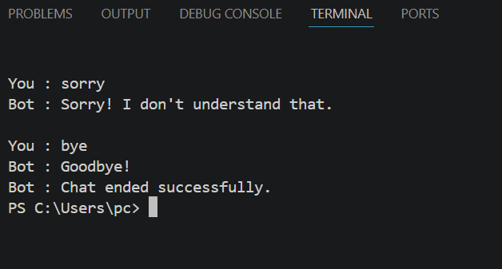

# DecodeLabs Internship - Rule-Based AI Chatbot

A simple **Rule-Based AI Chatbot** developed using **Python** as part of the **DecodeLabs AI Internship Project**.

The chatbot responds to predefined user inputs using conditional logic. It also handles case-insensitive input and ignores extra spaces to provide a better user experience.

---

## Features

- Greeting Responses (Hello, Hi, Hey)
- "How are you?" Response
- Chatbot Introduction
- Current Date & Time
- Random Joke Generator
- Random Motivational Quotes
- Help Command
- Thank You Response
- Exit Command
- Case-insensitive Input
- Ignores Extra Spaces

---

## Technologies Used

- Python 3
- Random Module
- Datetime Module

---

## Project Structure

```text
DecodeLabs-Internship-Rule-Based-AI-Chatbot/
│
├── screenshot/
│   └── chatbot_output.png
│
├── main.py
├── README.md
└── requirements.txt
```

---

## How to Run

1. Clone the repository

```bash
git clone https://github.com/md-ibna-labid/DecodeLabs-Internship-Rule-Based-AI-Chatbot.git
```

2. Open the project folder

```bash
cd DecodeLabs-Internship-Rule-Based-AI-Chatbot
```

3. Run the chatbot

```bash
python main.py
```

---

## Available Commands

| Command | Description |
|---------|-------------|
| hello / hi / hey | Greeting |
| how are you | Chatbot Status |
| your name | Bot Introduction |
| who created you | Developer Information |
| date | Show Current Date |
| time | Show Current Time |
| joke | Tell a Joke |
| motivate me | Motivation Quote |
| thanks | Thank You Response |
| help | Show Available Commands |
| bye | Exit Chatbot |

---

## 📷 Output



---

## Author

**Md. Ibna Labid**

B.Sc. in Computer Science & Engineering (CSE)

Daffodil International University

---

##Project Purpose

This project was developed as **Project 1** for the **DecodeLabs AI Internship Program** to demonstrate the implementation of a simple rule-based conversational chatbot using Python.

---